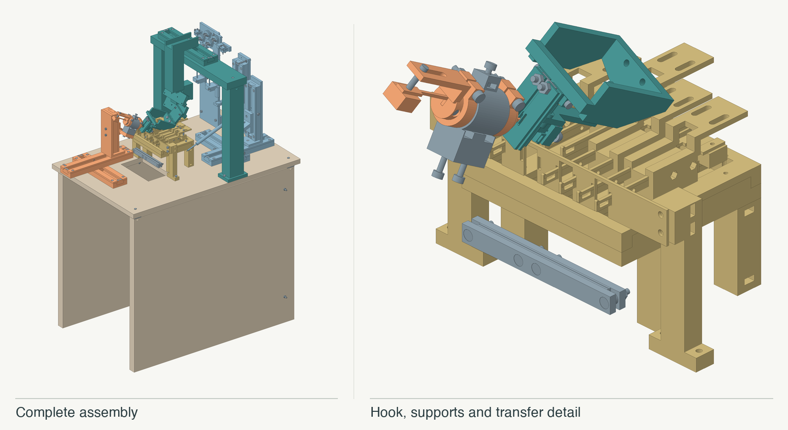

# Roche

**Crochet through mechanical registration.**

Roche explores how constrained yarn paths and repeatable tool motions can handle
a deformable material without cameras. The first application is a manually
actuated research prototype for stitch and swatch development.

[](cad/machine/generated/machine.step)

*Both views use the same assembly pose. The detail shows how the closable hook (orange) sits beside the paired supports (gold) and transfer mechanism (teal).*

The current **D26-T17-S3-indexed-candidate** design contains **692 installed native solids**.
It combines a closable hook, four paired-support stations, an indexed transfer
module, a gravity feeder, two retained service nips and a hanging fabric clamp.
Printed structural parts work with machined metal yarn-contact tools and
purchased fasteners and bearings.

- [Complete assembly STEP](cad/machine/generated/machine.step)
- [Individual manufacturing profiles](manufacturing/current/cad)
- [Parts register](docs/manufacturing_parts.csv)
- [Machine inputs](spec/current_machine.json)
- [Spring-mounted yarn retainer and STEP files](docs/YARN_RETAINER.md)
- [Sliding crochet gate, hook and individual STEP files](docs/CAPTURE_GATE.md)
- [257-member registered hook station, single STEP and installation instructions](cad/registered_station/README.md)
- [Shim-defined spring sockets, printable test coupon and metal cutting drawings](cad/shim_sockets/README.md)
- [Hook, stripper and spring mounting dimensions](docs/P5_MOUNTING.md)
- [Engineering and mechanics](docs/ENGINEERING.md)
- [Elastic interface benchmarks](docs/ELASTIC_INTERFACES.md)
- [Convex search methods and benchmarks](docs/CONVEX_SEARCH.md)
- [Bounded quadratic solvers and analytical tests](docs/BOUNDED_QUADRATIC.md)
- [Yarn length through a retracting guide](docs/GUIDE_TRAVEL.md)
- [Barrel stop, inspection gauge and assembled transfer head](cad/barrel_stop/README.md)
- [Sprung cloth clamp assemblies for two yarn diameters](cad/sprung_clamp/README.md)
- [A spring shoe for the fabric clamp](docs/PASSIVE_JAW.md)
- [A gravity-loaded carrier supported by yarn](docs/GRAVITY_CARRIER.md)
- [Yarn weight and force balance](docs/YARN_WEIGHT.md)
- [Continuous yarn self-clearance on an analytical coil](docs/YARN_CLEARANCE.md)
- [When the working yarn reaches the forming face](docs/FORMING_FACE.md)
- [Contact integration and analytical refinement](docs/CONTACT_INTEGRATION.md)
- [Yarn pressure on the machined knockover plate](docs/KNOCKOVER_PRESSURE.md)
- [Force at all four ends of a finite yarn contact](docs/FINITE_SEGMENTS.md)
- [Passing a folded strand through a ring](docs/BIGHT_PASSAGE.md)
- [Measuring two-direction yarn compliance](docs/SECTION_CALIBRATION.md)
- [A deformable yarn section against two supports](docs/TWO_CONTACT_SECTION.md)
- [Unilateral contact and friction benchmarks](docs/UNILATERAL_CONTACT.md)
- [Newton contact solver and analytical tests](docs/SEMISMOOTH_CONTACT.md)
- [Piloted service driver and screw CAD](docs/PILOTED_DRIVER.md)
- [Hex-drive fit and tolerance benchmark](docs/HEX_DRIVE_FIT.md)
- [Sizing a retaining screw near moving yarn](docs/RETAINING_SCREW.md)
- [Washer bearing area near a plate edge](docs/WASHER_SUPPORT.md)
- [Guide motion between indexed wheel positions](docs/INDEXED_GUIDE.md)
- [Pressure and shear under a mounted bracket](docs/PLANAR_JOINT.md)
- [Guide bracket mounting ring and STEP model](docs/BRACKET_RING.md)
- [Load transfer between indexed carriage stops](docs/INDEXED_LOAD_TRANSFER.md)
- [Passive work and stored energy along a command](docs/PASSIVE_WORK.md)
- [Seven-turn spool payout between yarn marks](docs/SPOOL_PAYOUT.md)
- [Research references](docs/REFERENCES.md)

```sh
python3.12 -m venv .venv
.venv/bin/python -m pip install -r cad/r5m2/requirements.lock.txt
.venv/bin/python -m cad.r5m2.build
.venv/bin/python -m cad.transfer.build
.venv/bin/python -m cad.machine.assembly
.venv/bin/python examples/feeder.py
.venv/bin/python examples/rod_energy.py
.venv/bin/python -m unittest discover -s tests -v
```

The code regenerates native CAD and executes mechanics examples. Numerical
examples declare their benchmark material properties; component measurements
and physical stitch trials establish application performance.

Created by [arushis1212](https://github.com/arushis1212).
